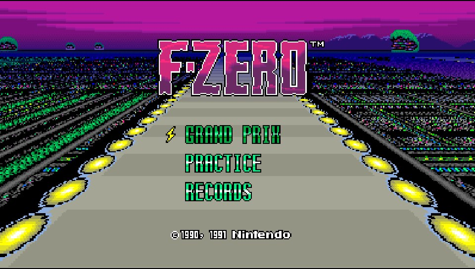
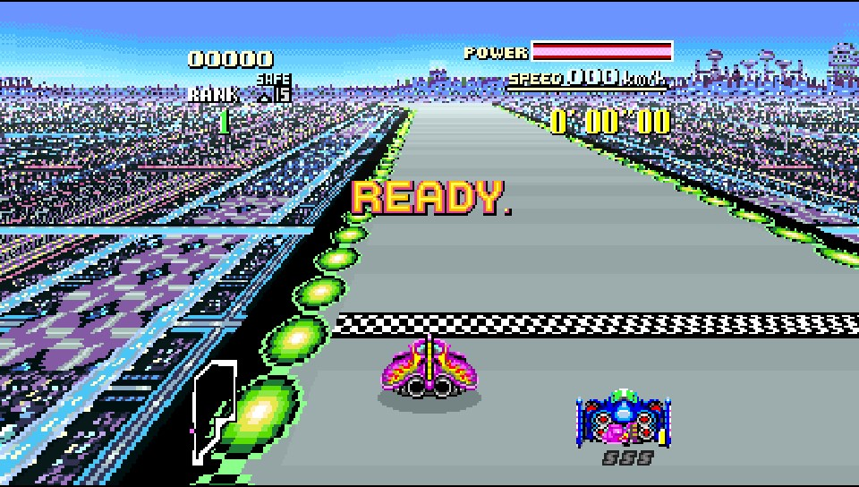

# F-Zero Recomp for PS Vita

A native static recompilation of *F-Zero (USA)* for the PlayStation Vita.

This is not an emulator. [snesrecomp](https://github.com/craigshaw/snesrecomp)
analyses the ROM ahead of time and emits C for every 65816 execution variant it
can prove, and that C is compiled into a Vita executable. Only what the
analysis cannot prove falls back to a shared interpreter. The SNES PPU, APU and
DSP are still simulated; the game's own code is not.

It runs at **full speed — 60.1 FPS with no dropped frames**, with audio, over
runs of 35,000+ frames without a fault.

<p align="center">
  
  
</p>

**You supply your own cartridge dump.** No ROM is included, and the recompiled
C is not part of this repository — you generate it locally from your own copy.

## What works

- The full game: menus, Grand Prix, Practice, all tracks, at 60.1 FPS
- Audio, via the SPC700/DSP running on the Vita's second CPU core
- Battery-backed SRAM, loaded on boot and written back to `ux0:` when you exit cleanly
- D-pad or left analogue stick for steering

## What is not here

This tree is the Vita port only. Features that exist in the desktop fork —
the ROM-picker launcher, the in-game settings and pause menu, the visual
filters, the per-car records extension, screenshot capture — are **not wired on
Vita**. Some of their code still compiles in and is documented in `docs/`,
which describes the shared design rather than this build's feature set.

**Widescreen is not shippable.** The 16:9 pass runs on device and is correct,
but its best measured result is 18.8 FPS. It is behind `-DFZERO_WIDESCREEN=ON`,
off by default, and exists to be measured, not played: 60 FPS widescreen is
not reachable along that path.

## Install

1. Build the VPK (below) or take one from a release.
2. Install `fzero_recomp.vpk` with VitaShell.
3. Create `ux0:/data/fzero_recomp/` and put your ROM there as `fzero.sfc`.

### Files on the Vita

| Path | |
| --- | --- |
| `ux0:/data/fzero_recomp/fzero.sfc` | your ROM — required, the app exits without it |
| `ux0:/data/fzero_recomp/saves/save.srm` | battery SRAM |
| `ux0:/data/fzero_recomp/saves/` | save directory |

## Controls

| Vita | SNES | In F-Zero |
| --- | --- | --- |
| ✕ | B | Accelerate |
| □ | Y | Brake |
| ○ | A | — |
| △ | X | — |
| L / R | L / R | Air brakes |
| D-pad or left stick | D-pad | Steer |
| START | START | Pause |
| SELECT | SELECT | — |
| **L + R + START, held ~0.2 s** | — | **Soft reset** — returns to the title screen (preserves battery saves) |

Quit by pressing the PS button and closing the app from LiveArea. SRAM is
saved automatically on suspend and on clean exit.

## ROM requirements

Generation needs a **headerless F-Zero (USA)** cartridge dump:

| Property | Value |
| --- | --- |
| Size | 524,288 bytes |
| Mapping | LoROM |
| SHA-256 | `bf16c3c867c58e2ab061c70de9295b6930d63f29f81cc986f5ecae03e0ad18d2` |

`tools/regenerate.sh` verifies this hash and refuses anything else. The same
payload with a 512-byte copier header is also accepted at runtime.

## Build from source

Requires VitaSDK, CMake 3.20+, Ninja, Python 3.11+ and Git.

```bash
git clone https://github.com/rameauv/FZeroRecomp-vita.git
cd FZeroRecomp-vita
git submodule update --init --recursive
export VITASDK=/path/to/vitasdk

# Emit generated/ from your own ROM. The script checks the ROM's SHA-256,
# applies the snesrecomp patches, and pins the analysis backend this build is
# known to match. Omit the argument to use "F-Zero (USA).sfc" beside this file.
sh tools/regenerate.sh /path/to/"F-Zero (USA).sfc"

sh build.sh
```

The result is `build-vita/fzero_recomp.vpk`.

`generated/` is ignored on purpose: it is recompiled ROM code, so it is a
derivative of the commercial ROM and must not be redistributed. Expect
`tools/regenerate.sh` to report **678 exact AOT variants and 9 LLE variants** —
other numbers mean the wrong analysis backend ran, which produces a build that
interprets functions the reference build compiles.

### Build options

All default to OFF. They are measurement instruments, not features; several
cost real frame time even when they only log.

| Option | |
| --- | --- |
| `FZERO_DIAG` | Bring-up probes: WRAM CRCs, stack write watch, interpreter step ring |
| `FZERO_PPUPROF` | Per-scanline rasteriser phase timings |
| `FZERO_WIDESCREEN` | Wire the 16:9 pass (≈18.8 FPS — measurement only) |
| `FZERO_WIDEPROF` | Per-site probes inside the widescreen pass |
| `FZERO_LOG_FILE` | Log to `ux0:/data/fzero_recomp/log.txt` instead of the netlog |

### Logging

On hardware the app logs over UDP to **`192.168.0.10:18194`** by default
(debugnet). That address is a compile-time constant in
[`src/platform_vita.c`](src/platform_vita.c) — a Vita launch has no
environment, so the `PSVITAIP` variable it also reads never fires on device.
Edit the constant, or build with `-DFZERO_LOG_FILE=ON` to get a file on `ux0:`
instead.

## Development

- [docs/ARCHITECTURE.md](docs/ARCHITECTURE.md) — frame scheduling, display
  composition, component ownership
- [docs/SNESRECOMP_PATCHES.md](docs/SNESRECOMP_PATCHES.md) — the reviewed
  integration process for the recompiler

Run the Python tests with `python3 -m pytest tests/`.

Generic recompiler changes belong in `snesrecomp`, not here.

## Credits and licence

Built on [snesrecomp](https://github.com/craigshaw/snesrecomp) and
[recomp-ui](https://github.com/mstan/recomp-ui), and the projects credited by
those dependencies. See [third-party notices](docs/THIRD_PARTY_NOTICES.md).

Original code in this repository uses the
[PolyForm Noncommercial License 1.0.0](LICENSE).

Required Notice: Copyright (c) 2026 Craig Shaw

Third-party code retains its respective licences. The ROM, the generated game
code, and the game artwork are not covered by the project licence. The
gameplay screenshots illustrate the project; the artwork shown belongs to its
respective rights holders. This project is not affiliated with or endorsed by
Nintendo. *F-Zero* and its related names and assets belong to their respective
owners.
